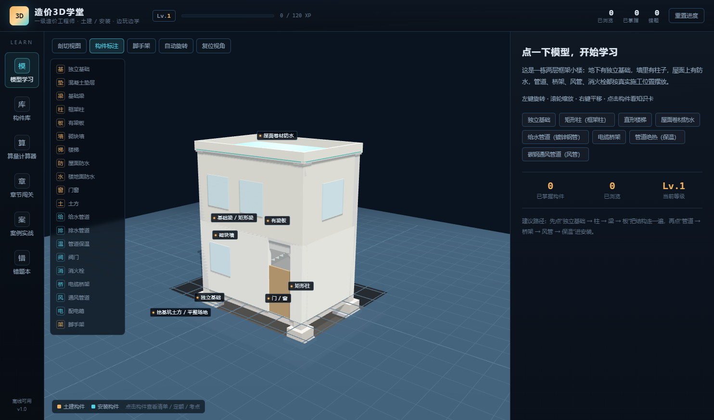
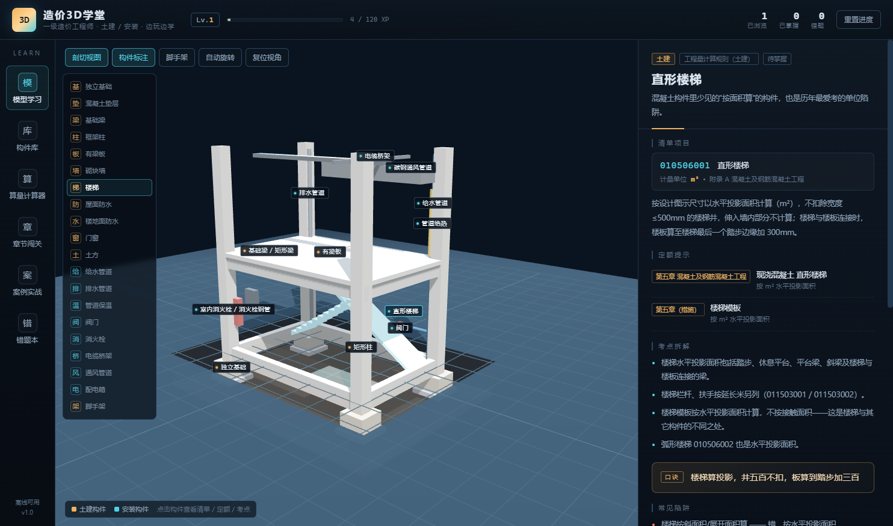
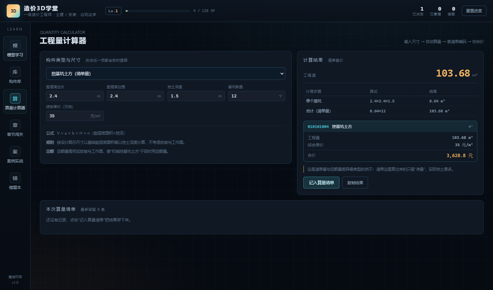
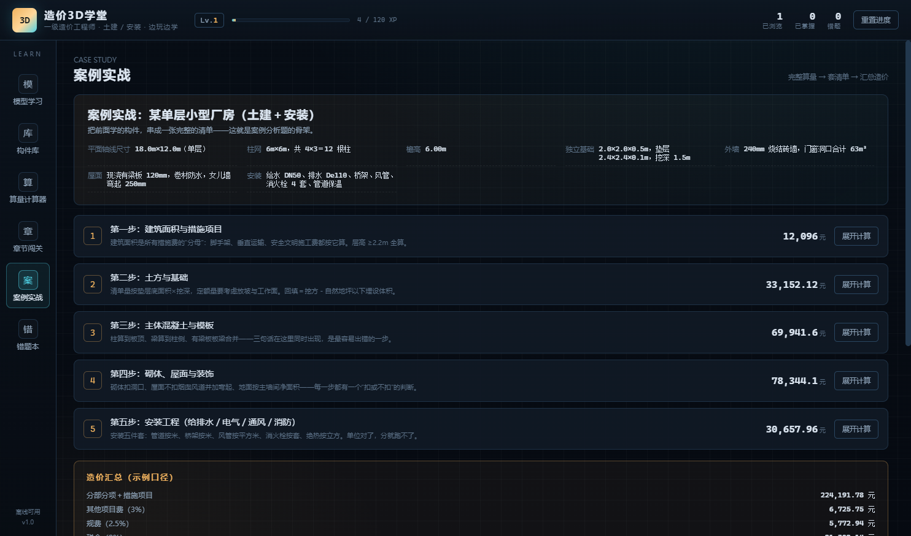
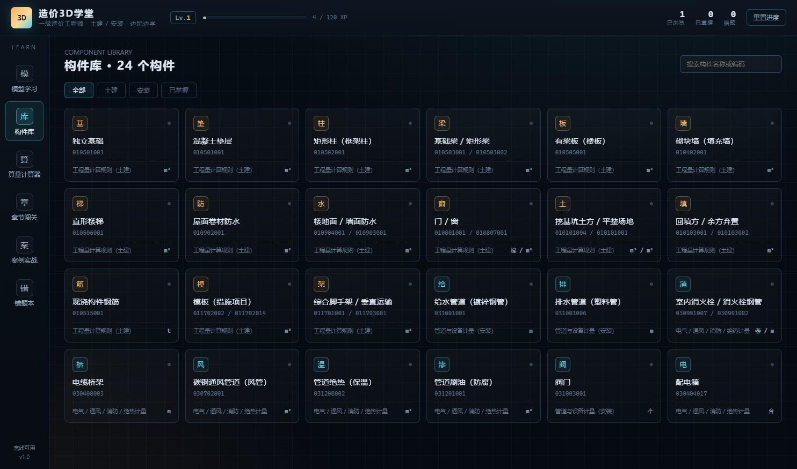

# 造价3D学堂 · Cost3DLab

> 给「零基础文科生」的 3D 造价学习工具：一边转动模型、点构件，一边学清单、定额、考点和口诀，辅助一级造价工程师 **土建建筑** + **安装** 两科备考。

不是网课，也不是背题库。它把一栋两层框架小楼做成可交互的 3D 模型，你点哪根柱子，右边就展开那根柱子的清单编码、计量单位、计算规则、定额子目、考点拆解、记忆口诀和两道小练习。



| 点构件 → 出知识卡 | 工程量计算器 |
| --- | --- |
|  |  |

| 案例实战（单层厂房完整算量） | 构件库（24 个构件） |
| --- | --- |
|  |  |

---

## 功能

**1. 模型学习（3D）**
- 一栋两层框架小楼（独立基础、垫层、基础梁、框架柱、有梁板、砖砌墙、楼梯、屋面防水、门窗）＋ 安装专业的给水管、排水管、保温、阀门、消火栓、电缆桥架、碳钢风管、配电箱。
- 左侧 24 个构件，点一下即联动高亮并弹出知识卡：清单编码（GB 50854 / GB 50856）、计量单位、计算规则、定额提示、考点拆解、口诀、真题小练习（答对加经验）。
- `剖切视图` 一键剥掉外墙、屋面、门窗，露出楼板、楼梯和管线；选中安装类构件会自动剖切。
- 支持鼠标左键旋转、滚轮缩放、右键平移，`自动旋转`、`复位视角`、`脚手架` 开关。

**2. 构件库**
24 个构件卡片，含楼梯、屋面卷材防水、楼地面/墙面防水、电缆桥架、碳钢通风管道、室内消火栓、管道绝热、管道刷油等；支持「全部 / 土建 / 安装 / 已掌握」筛选与关键词搜索。

**3. 工程量计算器**
20 个计算器，输入长宽高即出结果，并同时给出**计算步骤表、公式、规则提醒、定额提示、套清单编码、合价**。覆盖基坑土方、柱、板、楼梯、屋面、钢筋、模板、矩形/圆形风管、绝热层、保护层等。结果可「记入算量清单」留存。

**4. 章节闯关**
9 章按教材顺序编排（工程地质 → 工程构造 → 工程材料 → 施工技术 → 工程量计算规则(土建) → 安装材料与施工 → 管道与设备计量 → 电气/通风/消防/绝热计量 → 计价与案例），每章带导读、小测和进度；答错自动进错题本。

**5. 案例实战**
单层小厂房（18×12m，柱距 6m，檐高 6m）完整算量 5 步：建筑面积与措施项目 → 土方与基础 → 主体混凝土与模板 → 砌体屋面装饰 → 安装工程，最后汇总到造价（分部分项 224,191.78 元 + 其他项目费 3% + 规费 2.5% + 税金 9%）。每步可展开算式表。

**6. 错题本 / 经验等级**
答错的题自动收集，可重做；浏览、掌握构件、答对题目都会积累 XP，等级提升。

---

## 快速开始

### 方式一：直接下载可执行文件

到 [Releases](../../releases) 下载 `Cost3DLab-x.x.x.exe`，双击运行即可。
单文件便携版，**免安装、完全离线**，不会访问网络，也不需要额外运行库。

> Windows 首次运行可能出现 SmartScreen 提示（未做代码签名），点「更多信息 → 仍要运行」即可。

### 方式二：自行构建

需要 Node.js 18+：

```bash
git clone https://github.com/<your-name>/Cost3DLab.git
cd Cost3DLab
npm install
npm start          # 开发模式运行
npm run dist       # 打包成 Windows 单文件 exe（输出到 dist/）
```

国内网络下载 Electron 较慢时，可先设置镜像：

```bash
# PowerShell
$env:ELECTRON_MIRROR="https://npmmirror.com/mirrors/electron/"
$env:ELECTRON_BUILDER_BINARIES_MIRROR="https://npmmirror.com/mirrors/electron-builder-binaries/"
npm install
npm run dist
```

---

## 目录结构

```
Cost3DLab/
├── main.js                  # Electron 主进程（窗口、菜单、日志、外链）
├── preload.js               # 预加载脚本（contextBridge）
├── package.json             # 依赖与 electron-builder 打包配置
├── build/                   # 打包资源（应用图标）
├── docs/screenshots/        # README 截图
└── renderer/                # 渲染进程（界面与全部业务逻辑，纯前端）
    ├── index.html           # 六个视图的骨架
    ├── css/style.css        # 深色蓝图主题
    ├── js/
    │   ├── model3d.js       # three.js 场景：建模、剖切、标注、拾取、聚焦
    │   ├── data-components-civil.js  # 15 个土建构件知识卡
    │   ├── data-components-mep.js    # 9 个安装构件知识卡
    │   ├── data-learn.js    # 9 章知识体系与章节题
    │   ├── data-calc.js     # 20 个算量计算器（公式、规则、清单）
    │   ├── data-case.js     # 厂房案例 5 步数据
    │   └── app.js           # 视图路由、知识卡、判分、错题本、XP
    └── lib/                 # 离线依赖：three.js r128 + OrbitControls
```

技术栈：Electron 32 + 原生 HTML/CSS/JS + three.js r128（本地内置，无 CDN 依赖）。

---

## 怎么加自己的内容

**加一个构件**：在 `renderer/js/data-components-*.js` 里追加一条，字段含义：

```js
{
  id: 'stair',            // 唯一 id，同时是 3D 模型里的 compId
  name: '直形楼梯',
  major: '土建',
  code: '010506001',      // 清单编码
  codeName: '直形楼梯',
  codeChapter: '附录 A 混凝土及钢筋混凝土工程',
  unit: 'm²',
  rule: '……计算规则……',
  quota: [{ chapter: '第五章 混凝土及钢筋混凝土工程', name: '现浇混凝土 直形楼梯', unit: 'm² 水平投影面积' }],
  points: ['……考点……'],
  mnemonic: '……口诀……',
  quiz: [{ q: '……', options: ['A', 'B'], answer: 1, explain: '……' }]
}
```

若想让它在 3D 里出现，在 `model3d.js` 的 `build()` 中用 `box(id, w, h, d, x, y, z, color, { part })` 或 `cyl(...)` 建模，并在 `A`（标注锚点）数组里加一行。

**加一个计算器**：在 `data-calc.js` 的 `CALC_TYPES` 里追加一条，`inputs` 定义输入项，`precompute(v)` 与 `formula(v)` 负责算量与算式，`rule / quota / price` 给规则、定额和教学单价。

---

## 内容口径与免责声明

- 清单编码按 **GB 50854-2013（房屋建筑与装饰工程）**、**GB 50856-2013（通用安装工程）** 编写；2024 版计算标准对部分规则有微调，**请以你当年考试教材为准**。
- 定额只标注消耗量定额的**章节与子目名称**，不写具体地区定额编号，避免误记。
- 所有综合单价均为**教学示例值**，用于练习算式，不构成报价依据。
- 本项目是学习辅助工具，**与官方考试机构无关**，不保证覆盖全部考点，也不替代教材与真题。

## 参与贡献

欢迎提 Issue / PR：
- 补充构件知识卡、真题、口诀（请注明依据的规范条文或教材章节）
- 修正在算量公式、计算规则上的错误（这类反馈最有价值，请附推导）
- 改进 3D 表现或增加新的模型场景

## License

[MIT](LICENSE)
